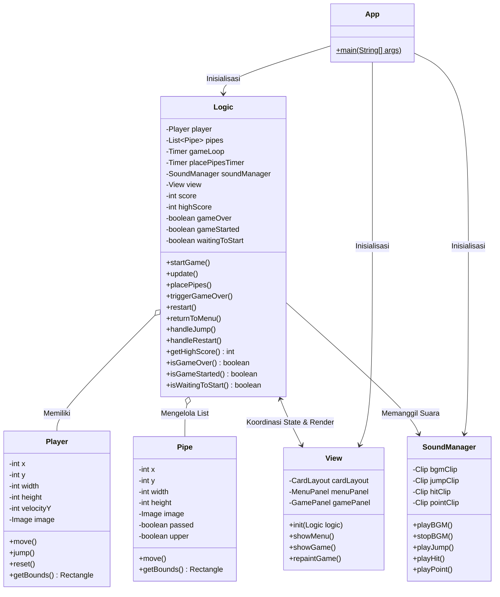

# Flappy Bird Desktop (Java Swing)

Implementasi desktop game **Flappy Bird** berbasis **Java Swing** dengan arsitektur berorientasi objek yang modular, bersih, dan memisahkan tanggung jawab antara *Presentation* (`View`), *Game Logic* (`Logic`), entitas objek (`Player`, `Pipe`), serta pengelolaan audio native (`SoundManager`).

Tugas Praktikum 6 - Desain & Pemrograman Berorientasi Objek (DPBO).

---

## 1. Desain Arsitektur & Struktur Proyek

Proyek ini menggunakan struktur standar Java tanpa dependensi eksternal (mengandalkan pustaka bawaan JDK 21+):

```text
TP6/
├── .idea/                    # Konfigurasi proyek IntelliJ IDEA (SDK, modules, run configs)
├── src/
│   ├── assets/
│   │   ├── ARCADEPI.TTF      # Font retro arcade untuk header & skor besar (28-36 pt)
│   │   ├── Early GameBoy.ttf # Font retro 8-bit untuk UI, tombol, & hints (12-16 pt)
│   │   ├── bird.png          # Sprite raster burung pemain (34x24 px)
│   │   ├── bird.svg          # Master vektor SVG karakter burung (dapat diedit)
│   │   ├── background.png    # Gambar latar belakang raster (360x640 px)
│   │   ├── background.svg    # Master vektor SVG latar belakang (dapat diedit)
│   │   ├── upperPipe.png     # Pipa atas menghadap ke bawah (64x512 px)
│   │   ├── upperPipe.svg     # Master vektor SVG pipa atas (dapat diedit)
│   │   ├── lowerPipe.png     # Pipa bawah menghadap ke atas (64x512 px)
│   │   ├── lowerPipe.svg     # Master vektor SVG pipa bawah (dapat diedit)
│   │   ├── jump.wav          # Efek suara saat burung mengepak/melompat
│   │   ├── point.wav         # Efek suara saat berhasil melewati rintangan
│   │   ├── hit.wav           # Efek suara saat menabrak pipa / jatuh
│   │   └── bgm.wav           # Musik latar (looping) selama permainan
│   ├── App.java              # Entry point utama & inisialisasi JFrame
│   ├── Player.java           # Model entitas burung pemain & fisika gerak
│   ├── Pipe.java             # Model entitas rintangan pipa
│   ├── SoundManager.java     # Pengelola audio native javax.sound.sampled
│   ├── View.java             # Pengelola UI (CardLayout: Menu & Gameplay)
│   └── Logic.java            # Pengendali alur, deteksi benturan, skor, & game loop
├── bin/                      # Direktori output bytecode hasil kompilasi terminal
├── TP6.iml                   # Definisi modul standar IntelliJ IDEA
└── README.md                 # Dokumentasi proyek & panduan penggunaan
```

### Diagram Alur Kelas & Arsitektur



---

## 2. Spesifikasi Teknis & Aturan Game

| Komponen | Spesifikasi / Nilai | Keterangan |
| :--- | :--- | :--- |
| **Dimensi Layar** | `360 x 640` piksel | Rasio portrait ringkas, `frame.setResizable(false)` |
| **Player (Burung)** | `x=180, y=320`, `width=34, height=24` | Kecepatan awal `velocityY=0` |
| **Fisika Burung** | Gravitasi = `+1`, Impuls Loncat = `-10` | Diperbarui per frame pada game loop |
| **Pipa (Rintangan)** | `width=64, height=512`, `velocityX=-2` | Bergerak konstan ke kiri |
| **Celah Pipa (Opening)** | `160` piksel (~1/4 tinggi layar) | Menjamin burung dapat lewat secara adil |
| **Spawn Interval** | `1500 ms` via `javax.swing.Timer` | Tinggi pipa atas diacak dalam batas aman |
| **Game Loop** | `60 FPS` (~16.6 ms per tick) | Menggerakkan entitas & me-render ulang kanvas |
| **Deteksi Tabrakan** | Bounding Box AABB (`java.awt.Rectangle`) | Cek tabrakan terhadap pipa & batas bawah frame |
| **Poin Terbaik** | Persistent in-session | Bertahan sepanjang aplikasi berjalan |

---

## 3. Cara Menjalankan & Memainkan Game (Step-by-Step)

### A. Persyaratan Sistem
- Java Development Kit (JDK) versi 21 atau yang lebih baru.
- Terminal / Command Prompt / IDE (IntelliJ IDEA, VS Code, Eclipse, NetBeans).

### B. Kompilasi & Menjalankan Melalui Terminal

1. Buka terminal dan arahkan ke direktori root proyek:
   ```bash
   cd /path/to/TP6
   ```

2. Buat folder `bin` dan kompilasi seluruh file Java (menargetkan Java 21):
   ```bash
   mkdir -p bin
   javac --release 21 -d bin src/*.java
   ```

3. Salin folder aset ke dalam `bin` agar classpath dapat menemukannya secara konsisten:
   ```bash
   cp -r src/assets bin/
   ```

4. Jalankan program:
   ```bash
   java -cp bin App
   ```

---

### C. Panduan Membuka & Menjalankan di IntelliJ IDEA

Proyek ini telah dikonfigurasikan dengan metadata proyek standar IntelliJ IDEA (`.idea/` dan `TP6.iml`), sehingga Anda dapat membukanya secara *out-of-the-box* tanpa perlu konfigurasi manual:

1. **Buka IntelliJ IDEA**:
   * Pada jendela selamat datang (*Welcome Screen*), klik tombol **Open** (atau pilih menu **File > Open...** jika sudah ada proyek lain yang terbuka).
2. **Pilih Folder Proyek**:
   * Arahkan ke folder `TP6`, lalu klik **OK** / **Open**.
   * Jika muncul dialog konfirmasi keamanan, pilih **Trust Project**.
3. **Verifikasi Project SDK (JDK 21+)**:
   * IntelliJ akan otomatis memuat proyek dan mengenali folder `src` sebagai **Sources Root** (berwarna biru).
   * Untuk memastikan SDK telah terdeteksi, buka menu **File > Project Structure... > Project** (shortcut: `Cmd + ;` di macOS / `Ctrl + Alt + Shift + S` di Windows).
   * Pastikan kolom **SDK** mengarah ke JDK 21 atau versi yang lebih tinggi.
4. **Menjalankan Game (Run)**:
   * **Cara 1 (Run Configuration bawaan):** Pada toolbar bagian atas IntelliJ, sudah tersedia konfigurasi bawaan bernama **`App`**. Cukup klik ikon tombol **Play (Run) hijau ▶**.
   * **Cara 2 (Langsung dari source code):** Buka file `src/App.java`, klik ikon panah hijau **▶** pada baris `public static void main(String[] args)`, lalu pilih **Run 'App.main()'**.

---

### D. Panduan Interaksi Pengguna (Langkah Demi Langkah)

#### 1. Masuk ke Main Menu (State Awal)
* Saat aplikasi pertama kali dibuka, layar **tidak langsung memainkan game**, melainkan menampilkan antarmuka **Main Menu**.
* **Informasi di Menu:**
  * Menampilkan judul game, preview burung, dan rekor **Poin Terbaik Sesi Ini** jika pemain sudah pernah memainkan ronde sebelumnya.
* **Tombol yang diklik:**
  * Klik tombol hijau bertuliskan **"Mulai Game"** di bagian tengah menu untuk memulai permainan.
  * Klik tombol merah bertuliskan **"Keluar"** di bawah tombol Mulai Game jika ingin menutup aplikasi secara langsung (`System.exit(0)`).

#### 2. Mode Siaga & Mengendalikan Burung Selama Permainan
* **Mode Siaga (Standby):** Saat tombol "Mulai Game" (atau "Try Again") diklik, layar berpindah ke kanvas gameplay, namun **burung tidak langsung jatuh** dan game belum langsung bergerak. Karakter berada diam di posisi awal (`x = 180, y = 320`) dan muncul petunjuk *"Tekan SPASI untuk Mulai"*.
* **Mengawali Permainan:**
  * Tekan tombol **`[SPASI]` (Spacebar)** pada keyboard. Burung akan seketika melompat ke atas (`jump velocity = -10`), musik latar (*BGM*) mulai diputar secara looping, timer pipa aktif, dan simulasi fisika dimulai.
  * Setelah game aktif berjalan, setiap penekanan tombol **`[SPASI]`** atau **Klik Kiri Mouse** akan membuat burung melompat kembali.
* Jika tidak ada input lompatan, burung akan ditarik ke bawah oleh gaya gravitasi (`gravity = +1`).

#### 3. Memantau Skor (Scoring System)
* **Posisi Indikator Skor:**
  * Skor terkini ditampilkan secara langsung di **pojok kiri atas layar** dengan teks tebal (*bold*) berwarna putih dan bayangan hitam agar kontras dengan latar belakang langit.
* **Mekanisme Penambahan Skor:**
  * Setiap kali burung berhasil melewati satu pasang pipa (posisi X burung melebihi sisi kanan pipa: `player.x > pipe.x + pipe.width`), skor bertambah **+1**.
  * Efek suara nada tinggi (*point chime*) akan berbunyi.
  * Sistem menandai flag `passed = true` hanya pada pipa atas dari pasangan tersebut sehingga skor **tidak pernah bertambah dua kali** untuk pasangan rintangan yang sama.

#### 4. Menghadapi Game Over & Poin Terbaik (High Score)
* Game Over terjadi secara otomatis jika:
  1. Bounding box burung bertabrakan dengan pipa atas maupun pipa bawah (AABB intersection).
  2. Burung jatuh menyentuh batas bawah frame (`posY >= frameHeight` atau batas kanvas 640 piksel).
* Saat tabrakan terjadi:
  * Game loop dan timer pembuat pipa seketika dihentikan.
  * Musik BGM berhenti dan efek suara benturan (*hit SFX*) dimainkan.
  * Sistem mengevaluasi apakah perolehan skor saat ini melampaui rekor tertinggi sesi ini. Jika ya, sistem menyimpan skor tersebut sebagai **Poin Terbaik (High Score)** baru.
  * Layar menampilkan lapisan gelap transparan dengan tulisan besar: **"GAME OVER"**.
  * Di bawah judul Game Over, ditampilkan:
    * **"Skor Akhir: [skor]"** (perolehan ronde berjalan).
    * **"Poin Terbaik: [skor tertinggi]"** (rekor terbaik yang tersimpan sepanjang sesi aplikasi dibuka).
    * Label **"★ REKOR BARU TERCAPAI! ★"** jika berhasil memecahkan rekor sebelumnya.

#### 5. Kontrol & Tombol Interaktif pada Layar Game Over
Pada layar Game Over, antarmuka dirancang rapi dan minimalis dengan dua tombol utama di layar:
1. **Tombol "Try Again"**:
   * **Aksi:** Klik tombol hijau bertuliskan **"Try Again"** di layar Game Over (atau tekan tombol **`[R]`** pada keyboard).
   * **Hasil:** Posisi burung seketika dikembalikan ke koordinat awal (`x = 180, y = 320`), seluruh pipa dibersihkan (`pipes.clear()`), skor di-reset ke `0`, dan game memasuki mode siaga (burung tidak langsung jatuh). Pemain dapat bersiap dan menekan tombol **`[SPASI]`** saat siap untuk mulai melompat. Poin terbaik tetap tersimpan dan tidak terhapus.
2. **Keterangan Poin Terbaik**:
   * Ditampilkan secara elegan sebagai teks keterangan berwarna kuning emas di bawah Skor Akhir (tanpa tombol terpisah).
3. **Tombol "Kembali ke Menu"**:
   * **Aksi:** Klik tombol biru bertuliskan **"Kembali ke Menu"**.
   * **Hasil:** Menghentikan permainan dan membawa pemain kembali ke **Main Menu**. Di menu utama, informasi rekor poin terbaik juga ditampilkan di bawah ikon burung.

---

## 4. Format Grafis Vektor SVG & Kustomisasi Aset

Setiap aset gambar pada game ini disediakan dalam format raster (`.png`) untuk runtime bawaan Java, dan format vektor murni (`.svg`) di dalam direktori `src/assets/` yang dapat diedit langsung menggunakan editor vektor seperti Figma, Adobe Illustrator, Inkscape, atau VS Code:

| File SVG | Dimensi Kanvas | Elemen Vektor yang Dapat Diedit |
| :--- | :--- | :--- |
| **`bird.svg`** | `34 x 24` px | Warna badan, warna sayap, bentuk paruh, mata, dan efek blush pipi |
| **`background.svg`** | `360 x 640` px | Gradasi warna langit, bentuk awan, siluet gedung kota, garis rumput, dan tanah |
| **`upperPipe.svg`** | `64 x 512` px | Gradasi warna hijau pipa, highlight kilau cahaya, bayangan, dan collar bawah |
| **`lowerPipe.svg`** | `64 x 512` px | Gradasi warna hijau pipa, highlight kilau cahaya, bayangan, dan collar atas |

> **Tips Kustomisasi:** Setelah mengedit file `.svg` pada aplikasi desain (misal Figma/Inkscape), lakukan export ke format `.png` dengan nama yang sama (`bird.png`, `background.png`, `upperPipe.png`, `lowerPipe.png`) lalu timpa file di dalam `src/assets/` untuk melihat perubahan visual langsung di dalam game.

---

### Tipografi & Font Retro Game

| Jenis Teks | Font yang Digunakan | Ukuran Font | Warna Teks |
| :--- | :--- | :--- | :--- |
| **Judul Menu ("FLAPPY BIRD")** | `Arcadepix Plus` (`ARCADEPI.TTF`) | `34 pt` | Kuning Emas (`#FFD700`) + Shadow |
| **Judul Game Over ("GAME OVER")** | `Arcadepix Plus` (`ARCADEPI.TTF`) | `34 pt` | Oranye Merah (`#FF4500`) + Shadow |
| **Skor Real-Time ("Score: X")** | `Arcadepix Plus` (`ARCADEPI.TTF`) | `28 pt` | Putih (`#FFFFFF`) + Shadow |
| **Skor Akhir ("Skor Akhir: X")** | `Arcadepix Plus` (`ARCADEPI.TTF`) | `28 pt` | Putih (`#FFFFFF`) + Shadow |
| **Teks Seluruh Tombol UI** | `Early GameBoy` (`Early GameBoy.ttf`) | `12 pt` | **Hitam Pekat (`#000000`)** |
| **Poin Terbaik / Rekor Baru / Hints** | `Early GameBoy` (`Early GameBoy.ttf`) | `12 - 14 pt` | Kuning / Hijau / Abu-abu |

---

## 5. Tampilan Antarmuka & Mockup Visual

### Main Menu
```text
+-----------------------------------+
|            FLAPPY BIRD            |
|               (o_>                |
|      Poin Terbaik Sesi Ini: 12    |
|                                   |
|       [   Mulai Game   ]          |
|                                   |
|       [     Keluar     ]          |
+-----------------------------------+
```

### Layar Game Over
```text
+-----------------------------------+
|            GAME OVER              |
|          Skor Akhir: 5            |
|        Poin Terbaik: 12           |
|                                   |
|       [    Try Again    ]         |
|                                   |
|       [ Kembali ke Menu ]         |
+-----------------------------------+
```

